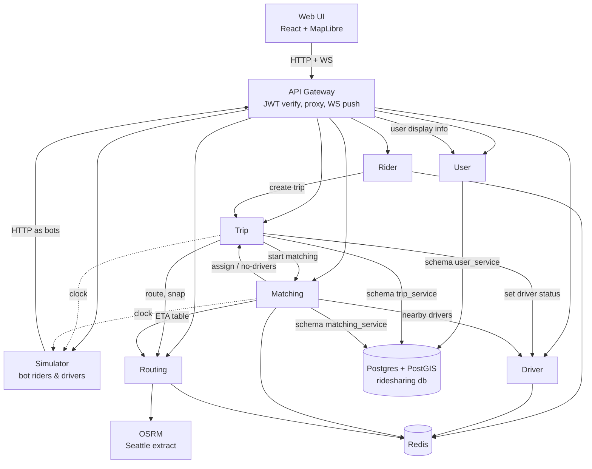
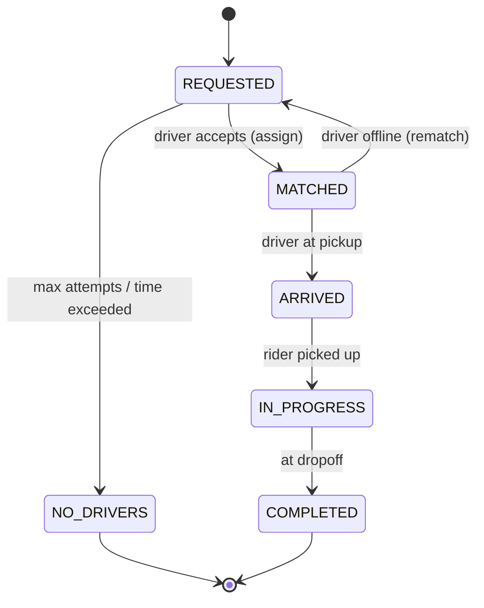
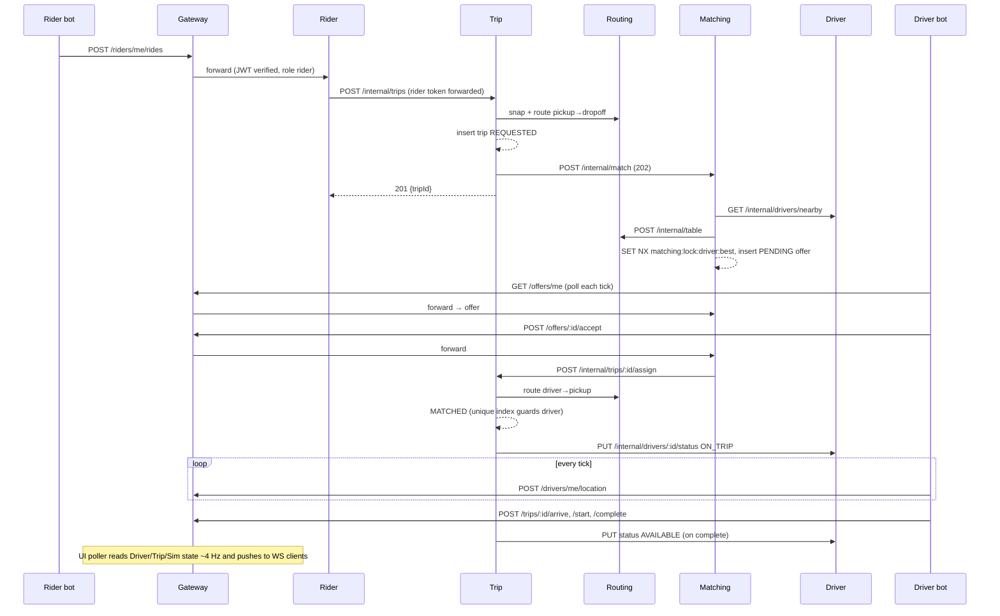

# System Design & Architecture

## Architecture Overview



All arrows are HTTP. **Identity rule:** every user — rider, driver, admin — and all of their profile data lives in the **User** service. A rider's or driver's ID everywhere in the system *is* their user ID, taken from the verified JWT `sub`; public APIs never accept a rider/driver ID in the request. Public routes go through the gateway, which is the **only** place tokens are verified; services decode the already-verified token with the shared `AuthContextModule` (see *Authentication & authorization*). Service-to-service calls use `/internal/*` routes (never proxied by the gateway). **No message broker** — a broker can be introduced later if a real fan-out or async-buffering need appears (see Design Decisions).

### Services

| Service | Port | Owns | Responsibility |
|---|---|---|---|
| gateway | 8080 | — | Single entry point and **only token verifier**: checks JWT signature/expiry (JWKS from user service) and the route-permission table, routes `/api/<svc>/*` (`/api/users/*` and `/api/auth/*` → user), injects `x-correlation-id`. WebSocket `/ws` for the admin UI: one internal poller (≈4 Hz) reads Driver/Trip/Simulator state and pushes snapshot + diffs to all connected UI clients. |
| user | 3001 | schema `user_service` | **Identity + all user data + authentication**: users, rider profiles, driver profiles (vehicle). Register/login, RS256 access (15 min) + refresh (7 d) tokens, JWKS, client-credentials tokens for internal calls (role `service`). Profile read/update (`/me`), batch user lookup for other services. Seeds `admin`. |
| rider | 3002 | Redis prefix `rider:` | **Rider live state only**: current position (streamed by the rider app/bot), served to the UI poller. Ride request entry point: resolves `pickup` (defaults to the rider's current position), validates, forwards rider token to Trip. No profile data. |
| driver | 3003 | Redis prefix `driver:` | **Driver live state only**: online/offline, status (`OFFLINE`/`AVAILABLE`/`ON_TRIP`), current trip, current position (streamed every tick), **GEO index of available drivers**. Serves nearby-driver queries to Matching. No profile data. |
| trip | 3004 | schema `trip_service` (PostGIS) | Trip state machine and history. Calls Routing for routes, Matching to start matching, Driver to update status. Enforces one active trip per rider and per driver in the DB. Stats endpoint. |
| matching | 3005 | schema `matching_service`, Redis prefix `matching:` | On match request: candidates (Driver) → ETA rank (Routing) → offer with lock + timeout → fallback / widen radius → no-drivers. Runs matching jobs in-process in the background. Accept/decline API. |
| routing | 3006 | Redis prefix `routing:` (cache) | Thin wrapper over OSRM: route, ETA table, nearest-road snap (rejects snaps > 150 m). Caches by rounded coordinates. |
| simulator | 3007 | in-memory | Sim clock (speed/pause) served at `/internal/clock`. Spawns rider bots (random or admin-specified), keeps N driver bots online. Bots use only public APIs via the gateway. Admin config API. |
| web | 5173 | — | Map UI. |

### Infrastructure (docker-compose)

- **Postgres 16 + PostGIS** — **one container, one database (`ridesharing`), one schema per service**: `user_service`, `trip_service`, `matching_service` (`user` is a reserved word, hence the `_service` suffix). Rider and Driver have no Postgres — their data is live state.
  - **Ownership enforced by roles:** each service connects as its own login role (`user_service`, `trip_service`, `matching_service`) that owns only its schema, has `search_path` set to it, and has **no privileges on other schemas** (`REVOKE ALL ON SCHEMA public FROM PUBLIC`). A query into another service's schema fails with `permission denied`.
  - `infra/postgres/init.sql` creates the database, roles, schemas and the `postgis` extension (in its own `postgis` schema, `USAGE` granted to `trip_service`). Role passwords via `.env`.
  - Each service runs its own Drizzle migrations into its own schema (`pgSchema('trip_service')`, migrations table in the same schema) — services migrate independently.
  - Splitting a schema into its own database later is a connection-string change, since nothing crosses schemas.
- **Redis 7** ×1, single logical DB (`0`), **one key prefix per service**: `rider:`, `driver:`, `matching:`, `routing:`. **AOF persistence enabled** (`appendonly yes`, `everysec`) because Driver/Rider live state lives only in Redis.
  - Each service has its own `REDIS_URL` and `REDIS_KEY_PREFIX` env vars. The shared `RedisModule` in `packages/common` creates an ioredis client with `keyPrefix`, so service code writes unprefixed keys (`state:{id}`) and Redis stores `driver:state:{id}`. Lua scripts get prefixed `KEYS[]` automatically; `SCAN`/`KEYS` patterns are not auto-prefixed, so the module wraps them.
  - **Ownership enforced by ACL users** (mirrors the Postgres roles): `infra/redis/users.acl` defines one user per service restricted to its own key pattern, e.g. `user driver on >${pw} ~driver:* &none +@all -@dangerous`. Touching another prefix fails with `NOPERM`; `default` user disabled.
  - Moving a service to its own Redis later = point its `REDIS_URL` at the new instance (optionally drop the prefix); no code change. Cross-prefix operations are forbidden, so nothing breaks when split.
- **OSRM** `ghcr.io/project-osrm/osrm-backend:v5.27.1` (multi-arch, native arm64; car profile, MLD) serving Seattle.
- **Map data** committed at `infra/osrm/seattle.osm.pbf` (~10 MB): Geofabrik `washington-latest.osm.pbf` (2023-10-23) clipped with `osmium extract -b -122.42,47.57,-122.27,47.67`. Fresh clones need no download. Source `.osm.pbf` files are gitignored; `infra/osrm/clip.sh <washington.osm.pbf>` re-clips (osmium in a throwaway container) to refresh the data.
- **`osrm-prep`** one-shot service (runs before OSRM; skips if processed data in the named volume matches the committed pbf's checksum): `osrm-extract -p car.lua` → `osrm-partition` → `osrm-customize`. Measured: ~2 s, ~160 MB peak RAM, ~43 MB output.

### Tech stack

- Node **22.23.4** (pinned in `.nvmrc` and `package.json` `engines`, enforced by `engine-strict=true` in `.npmrc`; Docker images use `node:22.23.4`), TypeScript, **npm workspaces** monorepo.
- **NestJS 11** (default Express platform, `@nestjs/platform-express`) for every backend service: modules, DI, guards, decorators. Same structure in each service: `*.module.ts`, `*.controller.ts`, `*.service.ts`, `*.repository.ts`.
- **Zod** for contracts + validation via `nestjs-zod` (`createZodDto`), so `packages/contracts` stays the single schema source.
- Config via `@nestjs/config` + Zod env schema; logging via `nestjs-pino`; health via `@nestjs/terminus`; scheduled work (sweepers, reconcile, poller) via `@nestjs/schedule`.
- Gateway: Nest app with `http-proxy-middleware` applied through `MiddlewareConsumer` (a `JwtVerifyMiddleware` runs before the proxy middleware, so it covers every proxied route); admin WebSocket via `@nestjs/websockets` + `ws` adapter.
- **Drizzle ORM** + drizzle-kit migrations (custom types for PostGIS `geography`).
- **ioredis**, **jose** (gateway: verify via JWKS; user service: sign), **bcryptjs**, **pino** (JSON logs), **undici** (HTTP client with retries).
- Web: **React + Vite + MapLibre GL**, Zustand.
- Tests: **Vitest** (+ `unplugin-swc` for decorator metadata), `@nestjs/testing` (`Test.createTestingModule`, provider overrides), **Testcontainers** for Postgres/Redis.

### Repository layout

```
apps/
  gateway/ user/ rider/ driver/ trip/ matching/ routing/ simulator/ web/
packages/
  common/   # config, logger, errors, HTTP client (correlation id, retry, token forwarding), SimClock, health,
            # auth module (AuthContextMiddleware, @CurrentUser, @Roles, @Public, RolesGuard), service-token client
  contracts/# Zod schemas + types for every public and internal API
  geo/      # polyline decode, haversine, interpolate-along-route, bbox random point
infra/
  docker-compose.yml, osrm/prep.sh, postgres init
```

### Authentication & authorization (verify once at the gateway)

**Trust model.** The gateway is the only component that verifies tokens. Services behind it **decode without verifying** and trust the claims. This is safe only because the trust boundary is the compose network: **only `gateway` (8080) and `web` (5173) publish host ports**; every other service is reachable only on the internal network.

| Layer | Does | Doesn't |
|---|---|---|
| **user** service | Signs RS256 tokens, serves JWKS | — |
| **gateway** | Verifies signature + expiry (`jose`, JWKS cached); enforces a **route-permission table** (coarse role per method + path prefix, e.g. `/api/sim/*` → admin, `POST /api/offers/*` → driver, `/api/riders/*` → rider); rejects with 401/403 before proxying; forwards the original `Authorization` header unchanged | Resource-level checks (needs service data) |
| **services** | Decode the bearer token via the shared `AuthContextModule` → `@CurrentUser()`, `@Roles()`; **resource-level authorization** (e.g. only the assigned driver may complete a trip; a rider may only read their own trip) | Signature verification, key handling |

**Shared auth module — `packages/common/auth`** (NestJS, no crypto):

```ts
// apps/<svc>/src/app.module.ts
@Module({ imports: [AuthContextModule] })   // global middleware decodes JWT → req.user; registers RolesGuard globally
export class AppModule {}

// apps/driver/src/drivers.controller.ts
@Controller('drivers/me')
export class DriversController {
  constructor(private readonly drivers: DriversService) {}

  @Post('location')
  @Roles('driver')
  updateLocation(@CurrentUser() user: AuthUser, @Body() dto: LocationDto) {
    return this.drivers.updateLocation(user.id, dto);
  }
}
```

- `AuthUser = { id: string; role: 'rider' | 'driver' | 'admin' | 'service'; exp: number }` — `id` = JWT `sub`.
- `AuthContextMiddleware` decodes the bearer token (`jose.decodeJwt`, no verification) into `req.user`, or `null` if missing/undecodable.
- `@CurrentUser()` — param decorator returning `req.user`.
- `@Roles(...roles)` + global `RolesGuard` — no user → 401, wrong role → 403. `@Public()` opts a route out (health, register, login). Defense in depth only; the gateway already enforced coarse roles.
- Handlers **never** read rider/driver IDs from params/body for "me" operations — only `@CurrentUser()`.

**Service-to-service calls.**
- *On behalf of a user* (e.g. Rider → Trip create): forward the user's original `Authorization` header; the callee decodes the same `request.user`. Trip reads the rider id from the token itself — the body carries no `riderId`.
- *System calls* (Matching → Trip assign, Trip → Driver status, gateway poller): a **service token** (`role: 'service'`, `sub` = service name) obtained once from the user service via client credentials and refreshed before expiry; `/internal/*` controllers use `@Roles('service')`.
- `/internal/*` paths are never proxied by the gateway.

## Data Models

### `user_service` schema (single source of truth for people)
- `users(id uuid pk, email text unique, password_hash text, role enum('rider','driver','admin','service'), name text, phone text null, created_at, updated_at)`
- `rider_profiles(user_id uuid pk fk → users.id, created_at)` — rider-specific fields go here as they appear
- `driver_profiles(user_id uuid pk fk → users.id, vehicle_make, vehicle_model, vehicle_color, vehicle_plate unique, created_at)`
- `refresh_tokens(id uuid pk, user_id fk, token_hash text, expires_at, revoked_at null)`
- `service_clients(client_id pk, secret_hash, name)` — internal callers

### Rider live state (Redis, prefix `rider:`)
Keys shown fully qualified; code uses them without the prefix.
- `rider:pos:{id}` hash `{lat, lng, ts}` — current position; TTL 10 min, refreshed on every update. `id` = user id.

### Driver live state (Redis, prefix `driver:`)
- `driver:state:{id}` hash `{status, tripId, lat, lng, heading, ts}` — `id` = user id; status `OFFLINE`/`AVAILABLE`/`ON_TRIP`.
- `driver:geo:available` GEO set — member present only while `AVAILABLE` and position fresh.
- `driver:online` set — for the UI poller and reconcile job.
- Status changes use a small Lua script so the hash, GEO set and online set change atomically.
- Stale drivers (no location for 60 s real) are marked `OFFLINE` by a sweeper.

### `trip_service` schema (PostGIS)
- `trips(id uuid pk, rider_id (= user id), driver_id null (= user id), status, pickup geography(Point), dropoff geography(Point), trip_route geography(LineString), pickup_route geography(LineString) null, est_distance_m, est_duration_s, requested_at, matched_at, arrived_at, started_at, completed_at, ended_reason null, version int)` — sim-time timestamps.
- Partial unique indexes: `(rider_id) WHERE status IN (non-terminal)` and `(driver_id) WHERE status IN ('MATCHED','ARRIVED','IN_PROGRESS')` — the DB guarantees no rider/driver has two active trips.
- `trip_events(id, trip_id fk, from_status, to_status, at_sim, at_real, meta jsonb)` — inspector timeline.
- Optimistic concurrency via `version`.

### `matching_service` schema
- `offers(id uuid pk, trip_id, driver_id, status enum('PENDING','ACCEPTED','DECLINED','EXPIRED'), eta_s, attempt int, created_sim, expires_sim, resolved_sim)`
- `match_jobs(trip_id pk, status enum('ACTIVE','DONE','FAILED'), attempt int, radius_m, started_sim, updated_sim)` — lets in-flight jobs resume after a restart.
- Redis (prefix `matching:`): `matching:lock:driver:{id}` (`SET NX PX`, holds tripId while offer pending), `matching:trip:{id}:declined` (set of driverIds, TTL 1 h).

### Routing cache (Redis, prefix `routing:`)
- `routing:route:{fromLat,fromLng,toLat,toLng}` (coords rounded to 5 decimals), `routing:table:{sha1(sources|destinations)}`, `routing:nearest:{lat,lng}` — JSON, TTL 1 h.

### Trip state machine



Transitions are a pure function `transition(trip, action) → newState | Error` with unit tests; only the assigned driver may move MATCHED→ARRIVED→IN_PROGRESS→COMPLETED.

## API Design

All external routes via gateway at `/api/<service>/...` with `Authorization: Bearer <JWT>`. Request/response schemas live in `packages/contracts`.

### Public APIs

**user**
- `POST /users {email, password, name, phone?, role: 'rider'}` or `{..., role: 'driver', vehicle: {make, model, color, plate}}` → `{userId}` (creates user + profile in one transaction; admin seeded)
- `POST /auth/login {email,password}` → `{accessToken, refreshToken}`
- `POST /auth/refresh {refreshToken}` → new pair (rotation)
- `POST /auth/token {clientId, clientSecret}` → service token
- `GET /.well-known/jwks.json`
- `GET /users/me` · `PATCH /users/me {name?, phone?, vehicle?}` — own profile (vehicle only for drivers)
- admin: `GET /users/:id` (UI inspector: name, vehicle)

JWT claims: `sub` (user id), `role`, `iat`, `exp`. No profile data in the token — services that need display info call the User service.

**rider** (role rider; rider id = `sub`)
- `POST /riders/me/location {lat,lng}` → `204` · `GET /riders/me/location`
- `POST /riders/me/rides {pickup?, dropoff}` → `201 {tripId}` / `409 active trip` / `422 no pickup` (`pickup` defaults to the rider's current position from `rider:pos`; 422 if neither is available)

**driver** (role driver; driver id = `sub`)
- `POST /drivers/me/online {lat,lng}` · `POST /drivers/me/offline` (`409` if the current trip is `ARRIVED`/`IN_PROGRESS`; if `MATCHED`, Trip unassigns and rematches) · `GET /drivers/me` (live state)
- `POST /drivers/me/location {lat,lng,heading}` → `204`

**trip**
- `GET /trips/:id` (party or admin) — routes + timeline
- driver: `POST /trips/:id/arrive` · `/start` · `/complete` → `409` on invalid transition
- admin: `GET /trips?status=active` · `GET /trips/stats`

**matching** (role driver)
- `GET /offers/me` → current pending offer or `204`
- `POST /offers/:id/accept` → `200 {tripId}` | `410 expired` | `409 taken`
- `POST /offers/:id/decline` → `204`

**routing** (admin) — `GET /route`, `GET /nearest` (debug/UI)

**simulator** (admin)
- `GET /sim/config` · `PUT /sim/config {driverCount, spawnIntervalS, speed (0–10), paused, acceptProbability}`
- `POST /sim/riders {pickup, dropoff}` (click-to-add)

**gateway WebSocket** `/ws?token=...` (admin): `snapshot {drivers, trips, config, stats}` on connect, then `diff` frames every 250 ms.

### Internal APIs (service-to-service)

| Caller → Callee | Endpoint | Purpose |
|---|---|---|
| rider → trip | `POST /internal/trips {pickup,dropoff}` + forwarded rider token | Create trip; Trip takes `riderId` from the forwarded token's `sub` (`409` if rider has active trip) |
| trip → routing | `GET /internal/route?from&to` → `{distanceM, durationS, geometry, durations[]}` | Trip and pickup routes |
| trip → routing | `GET /internal/nearest?lat&lng` | Snap pickup/dropoff (`422` if not routable) |
| trip → matching | `POST /internal/match {tripId, pickup}` → `202` | Start background match job (idempotent per tripId) |
| matching → driver | `GET /internal/drivers/nearby?lat&lng&radiusM&limit` | Available drivers from GEO index |
| matching → routing | `POST /internal/table {sources, destinations}` → `{durations[][]}` | ETA ranking |
| matching → trip | `POST /internal/trips/:id/assign {driverId, offerId}` | `409` if not REQUESTED or driver busy |
| matching → trip | `POST /internal/trips/:id/no-drivers` | Give up |
| trip → driver | `PUT /internal/drivers/:id/status {status, tripId}` | ON_TRIP on assign, AVAILABLE on complete (idempotent, retried) |
| driver → trip | `POST /internal/trips/:id/unassign` | Driver went offline (or swept as stale) with a `MATCHED` trip → rematch; `409` if trip is `ARRIVED`/`IN_PROGRESS` |
| trip → matching | (same `/internal/match`) | Rematch after unassign |
| driver → trip | `GET /internal/trips/active?driverIds=` | Status reconcile job (every 30 s) |
| gateway, trip → user | `POST /internal/users/batch {ids}` → `[{id, name, role, vehicle?}]` | Display info for UI snapshot/inspector and trip detail (cached 60 s in caller) |
| gateway → driver / rider / trip / simulator | `GET /internal/drivers/online`, `GET /internal/riders/positions`, `GET /internal/trips/active`, `GET /internal/trips/stats`, `GET /internal/sim/state` | UI poller |
| trip, matching → simulator | `GET /internal/clock` → `{simTime, speed, paused}` | Sim time (cached ~1 s, extrapolated) |

Internal calls: user token forwarded when acting for a user, otherwise service token; timeout 2 s, retry with backoff on network errors / 5xx for idempotent endpoints, correlation id forwarded.

## Component Breakdown

### Key flow (sequence)



### Matching algorithm

1. `POST /internal/match` upserts a `match_jobs` row and schedules the job in-process (returns 202 immediately).
2. Attempt with radius `[1000, 2000, 4000] m`: `GET /internal/drivers/nearby` (closest 10), minus `matching:trip:{id}:declined`.
3. `POST /internal/table` → ETA per candidate; sort ascending.
4. For best candidate, `SET matching:lock:driver:{id} tripId NX PX <ttl>`; if lock fails, try next.
5. Insert `PENDING` offer with `expires_sim = now + 15 s`.
6. Accept → verify PENDING & not expired → Trip assign → `ACCEPTED`, release lock, job `DONE`. Trip `409` → offer `EXPIRED`, release lock, continue job.
7. Decline / expiry (sweeper every 250 ms on sim clock) → add to declined set, release lock, back to step 2.
8. After 3 radii with no acceptance or 60 sim-seconds → Trip `no-drivers`, job `FAILED`.
9. On startup, resume `ACTIVE` jobs.

Exclusivity has two layers: the Redis lock prevents two simultaneous offers to one driver; the Trip DB unique index guarantees a driver can never hold two active trips even if the lock fails.

### Simulator

- **Clock:** `simTime += realDelta × speed` unless paused; served at `/internal/clock` and in `/internal/sim/state`. Shared `SimClock` client in `packages/common` caches it and extrapolates between fetches (≤1 s staleness).
- **Driver bot:** register once via the User service (role `driver`, random vehicle; deterministic `driver-NNN@sim.local`, so restarts just log in), go online at a random snapped point in the bbox. Each tick (1 s real): post location; if idle, poll `GET /offers/me`; on offer, accept with `acceptProbability` after a small random delay, else decline. On accept: fetch trip → follow `pickupRoute` geometry (position interpolated by `elapsedSim` against OSRM per-segment durations) → `arrive` → wait 5–15 sim s → `start` → follow `tripRoute` → `complete` → idle.
- **Rider bot:** spawned every `spawnIntervalS` (sim time, jittered) at random snapped pickup/dropoff within bbox (min distance 500 m); registers/logs in via the User service (role `rider`, pooled accounts `rider-NNN@sim.local` reused after a trip ends); posts its position (= pickup) to Rider; requests ride; polls its trip every 2 s; disposed after `COMPLETED`/`NO_DRIVERS`.
- **Spawn bbox:** lng −122.3550…−122.3150, lat 47.5950…47.6300 (downtown Seattle: Pioneer Square → South Lake Union, waterfront → First Hill).
- Driver count change: spawn/retire bots (retire only idle bots).
- Bots share an HTTP client that refreshes the access token before its 15-min expiry and re-logs in if refresh fails.

### Gateway UI poller

- Every 250 ms real: `GET /internal/drivers/online` (positions + status), `GET /internal/riders/positions`, `GET /internal/trips/active` (only changed since last `updatedAt` cursor), every 2 s `GET /internal/trips/stats`, config from simulator.
- Computes diff vs last frame and broadcasts to admin WS clients. Runs only while ≥1 admin client is connected.

### Web UI

- `MapView` (MapLibre, free OSM-based style), layers: drivers (color by status), waiting riders (pin + pulse), routes (pickup leg dashed, trip leg solid), dropoff markers.
- `ControlPanel`: driver count, spawn interval, speed slider + pause, accept probability, "add rider" mode (two clicks, Esc cancels).
- `LoginPage`: admin email/password → `POST /api/auth/login`; tokens kept in memory, refreshed automatically via `/api/auth/refresh` before expiry; WS reconnects with the new token.
- `Inspector`: selected driver/rider → trip state, timeline (`GET /api/trips/:id`), driver/vehicle display info (`GET /api/users/:id`), ETA remaining computed client-side from the current route's per-segment durations and the driver's progress along it.
- `StatsPanel` (from `GET /internal/trips/stats`, sim time): online/available drivers (Driver), waiting riders = trips `REQUESTED`, active = `MATCHED`+`ARRIVED`+`IN_PROGRESS`, completed; avg wait-to-match = `matched_at − requested_at`, avg wait-to-pickup = `arrived_at − requested_at` (completed trips in the last 30 sim-min); match rate = `COMPLETED+active / (that + NO_DRIVERS)`.
- `useSimSocket`: snapshot + diffs into a Zustand store; interpolates positions between frames for smooth motion.

## Design Decisions

| Decision | Choice | Alternatives / trade-off |
|---|---|---|
| Backend framework | NestJS, default Express platform (user decision) | Plain Fastify (less boilerplate, but conventions are ours to invent across 8 services); NestJS on Fastify adapter (faster, but user chose plain NestJS). |
| Communication | HTTP only (user decision) | Broker (Kafka/Redpanda) for location fan-out and async decoupling — deferred: no current consumer needs it. Cost: caller must know callees and retry; Trip→Driver status update can fail transiently (mitigated by retries + idempotent endpoint + periodic reconcile). |
| Live UI updates | Gateway polls services, pushes over WS | Services push to gateway over HTTP (couples every service to the gateway); UI polls REST directly (N tabs × N requests). |
| Bot notifications | Bots poll offers / trip on their tick | Per-bot WebSocket (needs a push source → broker or service→gateway calls). |
| Geo index ownership | Driver owns Redis GEO; Matching queries it | Matching keeping its own copy (needs events to stay in sync). |
| Driver exclusivity | Redis `SET NX` lock + Trip partial unique index + `version` | Lock alone (not safe on lock expiry/races); DB alone (works, less illustrative of distributed locking). |
| Background matching | In-process job + `match_jobs` table for restart recovery | Synchronous matching inside the ride request (request would block for the whole offer window). |
| Routing | OSRM wrapper + Redis cache | Own A* (more learning, slower to build); pgRouting. |
| Map data | Seattle clip (10 MB) committed to repo | Download at setup (BBBike / Geofabrik — needs network, 267 MB for the WA extract, third-party availability); committing the full 267 MB extract (exceeds GitHub's 100 MB file limit). Committed clip = offline, reproducible, pinned data. |
| Sim time | Central SimClock in Simulator, fetched over HTTP | Real time only (trips take real minutes; no pause). |
| Identity & profiles | User service owns users + rider/driver profiles and authentication; IDs = JWT `sub` everywhere (user decision) | Separate Rider/Driver profile DBs (duplicated identity, IDs to keep in sync). Cost: User service is on the read path for display info → batch endpoint + 60 s caches in callers. |
| Rider/Driver persistence | Redis only, AOF on (user decision) | Redis + Postgres location history (enables replay; more containers and write load) — deferred. |
| Redis topology | One instance, key prefix + ACL user per service (user decision) | Logical DB index per service (`SELECT n`; not supported by Redis Cluster, no per-DB auth); instance per service (more containers). Prefix + ACL gives enforced isolation and a config-only path to separate instances. |
| Postgres topology | One database, one schema + one login role per service (user decision) | Container/database per service (strongest isolation, more memory and ops); one shared schema (no ownership boundary). Cost: shared instance is a single point of failure and noisy-neighbor risk — acceptable locally; isolation kept via per-schema roles. |
| Token verification | Verify once at the gateway; services decode via shared `AuthContextModule` (user decision) | Verify in every service (defense in depth, but duplicated JWKS fetching/crypto). Cost: a service reachable directly would accept forged tokens → mitigated by publishing only gateway + web ports. |
| Token signing | RS256 + JWKS (only gateway needs the public key) | HS256 shared secret (any holder could mint tokens). |
| Internal caller identity | Forward user token when acting for a user; service token otherwise | Trusted headers like `x-user-id` (easy to spoof if the gateway forgets to strip them); passing ids in bodies (breaks "IDs only from token"). |

## Non-Functional Requirements

- **Performance:** 200 drivers × (1 location + 1 offer poll)/s ≈ 400 req/s through gateway — within NestJS capacity on a laptop; offer poll skipped when bot is on a trip. Gateway poller ≈ 8–12 internal req/s regardless of UI tab count. Route cache key = coords rounded to 5 decimals.
- **Scalability:** stateless services except Simulator and Matching's in-process jobs (single instance by default; scale-out would need job leasing — out of scope).
- **Security:** bcrypt passwords, short-lived access tokens, refresh rotation, tokens verified once at the gateway (signature, expiry, route-permission table); services decode via `AuthContextModule` and do resource-level checks; rider/driver IDs only from token `sub` (request bodies can't impersonate); only gateway + web publish host ports; `/internal/*` requires `service` role and is never proxied by gateway. Secrets via `.env` (local only).
- **Reliability:** idempotent internal endpoints + retries; driver status reconcile job (Driver compares its `ON_TRIP` drivers against Trip's active trips every 30 s); services retry DB/Redis at startup; Redis AOF so Driver/Rider live state survives a Redis restart (losing it only means drivers re-send location / go online again); compose healthchecks + `depends_on: condition: service_healthy`; Matching resumes active jobs on restart.
- **Known limitations:** a driver that disappears during `ARRIVED`/`IN_PROGRESS` leaves the trip in place (stale sweeper marks the driver `OFFLINE`, unassign returns 409; no trip recovery) — bots never do this; WS token passed as query param (acceptable locally, would leak into access logs in production).
- **Observability:** pino JSON logs with `correlationId`, `service`, `tripId`/`driverId` where relevant; `GET /health` (liveness) and `/ready` (DB/Redis/dependency checks).
