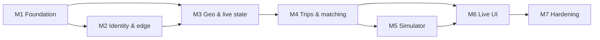

# Project Planning & Task Breakdown

Sources: requirements, design and testing docs dated 2026-10-21 for `ride-share-simulation`. Test references (e.g. *Tests: Unit › trip*) point to sections of the testing doc.

## Milestones

- [x] **M1 Foundation**: monorepo, shared packages, infra (Postgres/Redis/OSRM) up with isolation enforced.
- [x] **M2 Identity & edge**: User service + gateway; a rider can register, log in and call a protected echo route through the gateway.
- [x] **M3 Geo & live state**: Routing, Driver, Rider services; drivers go online and show up in `nearby`.
- [x] **M4 Trips & matching**: Trip + Matching + sim clock; a scripted rider/driver pair completes a trip over HTTP.
- [x] **M5 Simulator**: bots drive the full lifecycle headlessly; E2E "≥3 trips completed" passes.
- [ ] **M6 Live UI**: gateway WS poller + web app with map, controls, inspector, stats.
- [ ] **M7 Hardening**: E2E suite, perf run, README; ready for review.

Each milestone ends with a demoable result and green tests for everything built so far.

## Task Breakdown

### M1: Foundation

- [x] **1.1 Monorepo scaffold.** npm workspaces (`apps/*`, `packages/*`), TS base config, ESLint + Prettier, Vitest + `unplugin-swc` root config, `npm test` / `test:integration` / `test:e2e` scripts, `.env.example`.
  - Deps: none. Validation: `npm install && npm run build && npm test` green on an empty sample package.
  - Done 2026-10-23: Node pinned to 22.23.4 (`.nvmrc`, `engines`, `engine-strict`); npm workspaces; TS 5.9.3; NestJS 11.2.7; Vitest 4.1.12 + unplugin-swc 2.0.0 (Nest DI smoke test in `packages/common/test/nest-di.spec.ts` passes); ESLint 9 + typescript-eslint 8 + Prettier 3; three Vitest configs (unit / `*.int.spec.ts` / `*.e2e.spec.ts`). Vitest 3.2.7 replaced by 4.1.12 to clear 4 audit findings (2 critical in tinypool); `npm audit` = 0. Vite 7.3.7 pinned explicitly (Vitest 4 peer).
- [x] **1.2 `packages/contracts`.** Zod schemas + types for all public/internal APIs in the design (coords, trip, offer, driver state, sim config, users).
  - Deps: 1.1. Tests: Unit › packages/contracts.
  - Done 2026-10-23 (`35878a5`): pure Zod 4.6.7, no Nest deps (web can import it); strict request bodies (extra `riderId` rejected); 100% line coverage.
- [x] **1.3 `packages/geo`.** Polyline/GeoJSON decode, haversine, `interpolateAlongRoute(geometry, durations, elapsed)`, random point in bbox.
  - Deps: 1.1. Tests: Unit › packages/geo.
  - Done 2026-10-23 (`89fb5c9`): no runtime deps; also exports `SEATTLE_SPAWN_BBOX` / `SEATTLE_MAP_BBOX`; 100% statements/branches/functions/lines.
- [x] **1.4 `packages/common` core.** `ConfigModule` (Zod env), `nestjs-pino` logger with correlation id, error filter, health (`/health`, `/ready`), HTTP client (undici: timeout 2 s, retry/backoff on idempotent calls, correlation-id + token forwarding).
  - Deps: 1.1. Tests: Unit › packages/common — HTTP client.
  - Done 2026-10-23 (`fef071f`): `@nestjs/terminus` not used (own ~40-line health module with `ReadinessCheck`); HTTP client default auth = `forward`; `UpstreamError` maps to generic 500 (revisit 502 if useful); extension points for 1.5 (`TokenProvider`/`TOKEN_PROVIDER`, `requestContext`, `TODO(1.5)` public health routes) and 1.6 (`READINESS_CHECKS`).
- [x] **1.5 `packages/common` auth module.** `AuthContextMiddleware` (decode only), `@CurrentUser`, `@Roles`, `@Public`, global `RolesGuard`, service-token client.
  - Deps: 1.4. Tests: Unit › packages/common — auth module.
  - Done 2026-10-23 (`9de951a`): `jose` 6.2.12 decode-only; global `RolesGuard` means every non-`@Public()` route requires a user (user-service register/login/refresh must be `@Public()`); `ServiceTokenModule.register` (not global) provides `TOKEN_PROVIDER`.
- [x] **1.6 `packages/common` data modules.** `DatabaseModule` (Drizzle, per-service schema + migrations table), `RedisModule` (ioredis `keyPrefix`, wrapped `SCAN`, Lua helper), `SimClock` client.
  - Deps: 1.4. Tests: Unit › SimClock; Integration › RedisModule.
  - Done 2026-10-23 (`6663bba`): custom schema-local migration runner (no `CREATE SCHEMA`); readiness checks exported (`POSTGRES_READINESS`, `REDIS_READINESS`) but must be wired into `HealthModule` by each service; `SimClock.sync()` must be awaited on startup.
- [x] **1.7 Infra: Postgres + Redis.** `infra/docker-compose.yml` base; Postgres 16 + PostGIS with `infra/postgres/init.sql` (database, roles, schemas, `postgis` schema); Redis 7 with AOF and `infra/redis/users.acl` (per-service users, default disabled). No host ports except the future gateway/web.
  - Deps: 1.1. Tests: Integration › db isolation, redis isolation.
  - Done 2026-10-23 (`9392987`): `imresamu/postgis:16-3.5` (multi-arch); init as `infra/postgres/init/01-init.sh`; Redis ACL adds `+info` (found in review: `-@dangerous` blocked ioredis' ready check); tests in `tests/infra/` via Testcontainers compose + `exec`; `npm run infra:up|down|reset`.
- [x] **1.8 Infra: OSRM.** `osrm-prep` one-shot (checksum-guarded extract/partition/customize from committed `infra/osrm/seattle.osm.pbf`) + `osrm` service on `ghcr.io/project-osrm/osrm-backend:v5.27.1`; commit the existing `clip.sh` + pbf.
  - Deps: 1.7. Validation: `docker compose up osrm` → route Pike Place → Space Needle returns `Ok`.
  - Done 2026-10-23: checksum-guarded `osrm-prep` (rebuild ~2 s, skip ~0.3 s), healthcheck via bash `/dev/tcp` (image has no curl); included in `infra/docker-compose.yml`. Full stack `npm run infra:up` healthy in 13 s; route `Ok` 1638.2 m from inside the network.

### M2: Identity & edge

- [x] **2.1 User service: schema + register.** `user_service` migrations (users, rider_profiles, driver_profiles, refresh_tokens, service_clients); `POST /users` (rider / driver+vehicle in one tx); admin + service clients seeded.
  - Deps: 1.2, 1.5, 1.6, 1.7. Tests: Unit › user (register, driver profile).
  - Done 2026-10-23 (`42b8ca0`, with 2.2): drizzle-kit migration hand-edited to drop `CREATE SCHEMA`; monorepo now builds packages before apps and tests/typecheck resolve `@rideshare/*` to source; esbuild override under `@esbuild-kit/core-utils` clears GHSA-67mh-4wv8-2f99.
- [x] **2.2 User service: tokens.** RS256 key pair (generated on first boot, persisted in volume), `POST /auth/login`, `/auth/refresh` (rotation, reuse → 401), `/auth/token` (client credentials), JWKS.
  - Deps: 2.1. Tests: Unit › user (login/refresh/JWKS); Integration › user flow.
  - Done 2026-10-23 (`42b8ca0`): refresh-token families with reuse → family revocation (committed before the 401); constant-time-ish login via dummy bcrypt hash; `KEYS_DIR` needs a persistent volume.
- [x] **2.3 User service: profiles.** `GET/PATCH /users/me`, admin `GET /users/:id`, `POST /internal/users/batch`.
  - Deps: 2.2. Tests: Unit › user (me, batch).
  - Done 2026-10-23 (`5b6ba9b`): batch returns 200 (changed from Nest's POST default 201), one query, deduped.
- [x] **2.4 Gateway: verify + permissions + proxy.** `JwtVerifyMiddleware` (jose, JWKS cache, refetch on unknown `kid`), route-permission table, `http-proxy-middleware` per service, `/internal/*` → 404, correlation id injection, public routes (register/login/refresh/JWKS).
  - Deps: 2.2. Tests: Unit › gateway; Integration › gateway (401, internal not routable, correlation id).
  - Done 2026-10-23: route table in `apps/gateway/src/routes.ts`; `/api/auth/token` not exposed; JWKS outage → 503; Authorization stripped on public routes; accepted `braces` advisory (unreachable, documented in design).
- [x] **2.5 Compose wiring for M2.** user + gateway services with healthchecks/`depends_on`; only 8080 published.
  - Deps: 2.4. Validation (M2 demo): register rider → login → `GET /api/users/me` via gateway; direct call to user:3001 from host fails. Tests: Integration › compose ports.
  - Done 2026-10-23: one root `Dockerfile` (`--build-arg APP=<name>`, node:22.23.4-bookworm-slim, prod deps only, non-root, ~282 MB); `infra/services/<app>.compose.yml` pattern; `tests/e2e/m2.e2e.spec.ts` covers the demo, host isolation and correlation-id propagation. Adding a service: add its `package.json` COPY line to the Dockerfile, a compose file, the include, `SERVICE_ENV` in `tests/infra/stack.ts`, and the ports test.

### M3: Geo & live state

- [x] **3.1 Routing service.** `/internal/route`, `/internal/table`, `/internal/nearest` (150 m max snap) + admin debug routes; Redis cache (`routing:` prefix, rounded keys, TTL 1 h).
  - Deps: 1.6, 1.8. Tests: Unit › routing; Integration › routing vs OSRM (Pike Place → Space Needle, Elliott Bay → 422).
  - Done 2026-10-24 (`952b225`): OSRM per-edge annotations omit the snapped partial edges (195.6 s vs 236.7 s route), so durations are rescaled to sum to `durationS`; OSRM snaps route/table endpoints anywhere (only `/nearest` enforces 150 m), so callers must snap first; OSRM errors → 422/502 (`BadGatewayException`, since `UpstreamError` would map to 500).
- [x] **3.2 Driver service: live state.** `online/offline/location/GET me`; Lua script for atomic status (hash + GEO + online set); `GET /internal/drivers/nearby`, `/internal/drivers/online`, `PUT /internal/drivers/:id/status`; stale sweeper (60 s).
  - Deps: 1.5, 1.6. Tests: Integration › driver (live state, status idempotent, Lua atomicity, sweeper, AOF restart).
  - Done 2026-10-24 (`b93b7e5`): single `driverTransition` Lua script; offline while ON_TRIP → 409 (refined in 4.7); `|lat| > 85.05` → 400 (Redis GEO limit).
- [x] **3.3 Rider service: live state.** `POST/GET /riders/me/location` (`rider:pos:{sub}`, TTL 10 min); `GET /internal/riders/positions`. (Ride request lands in 4.4.)
  - Deps: 1.5, 1.6. Tests: Integration › rider location.
  - Done 2026-10-24 (`acab2bb`): `rider:pos:index` sorted set avoids SCAN for the poller; `RiderPositionsService.get()` ready for 4.4.
- [x] **3.4 Compose + gateway routes for M3.** Add routing/driver/rider; permission entries.
  - Deps: 3.1–3.3, 2.4. Validation (M3 demo): two drivers go online via gateway → `nearby` from inside network returns them closest-first.
  - Done 2026-10-24: `tests/e2e/m3.e2e.spec.ts`; gateway now `depends_on` rider/driver/routing healthy; real ACLs work unchanged (driver Lua via EVALSHA OK). Also on main: `043f60c` multer 2.5.0 override (GHSA-q7qp-rjg7-q26m).

### M4: Trips & matching

- [x] **4.1 Simulator: clock only.** Simulator app skeleton with clock (speed/pause), `GET /internal/clock`, `GET/PUT /sim/config` (admin), `/internal/sim/state`.
  - Deps: 1.4, 1.5. Tests: Unit › SimClock (server side).
  - Done 2026-10-24 (`aaf7782`): lazily computed clock re-based on speed/pause changes; `SimStore.onChange` for M5 bots.
- [x] **4.2 Trip service: domain + schema.** `trip_service` migrations (PostGIS columns, partial unique indexes, `trip_events`, `version`); pure `transition()` state machine.
  - Deps: 1.6, 1.7. Tests: Unit › trip — state machine; Integration › migrations.
  - Done 2026-10-24 (`69f5797`): PostGIS qualified as `postgis.*` (pool search_path is the service schema only); route durations stored as `double precision[]`.
- [x] **4.3 Trip service: APIs.** `POST /internal/trips` (rider from forwarded token; snap + route via Routing; call Matching), `GET /trips/:id` (party/admin), driver `arrive/start/complete`, internal `assign` (optimistic version, 409s), `no-drivers`, `unassign` (MATCHED only), `GET /internal/trips/active`, `/internal/trips/stats`; Driver status calls with retry; sim-time timestamps.
  - Deps: 4.1, 4.2, 3.1, 3.2. Tests: Integration › trip (create, concurrent assign, busy driver, retry, stats formulas, riderId from token).
  - Done 2026-10-24 (`9f428c9`, `2d6f1e6`): fixed common `ServiceTokenModule` not being visible to `SimClockModule` (now global); `AssignTripRequest` gained `driverPosition`; dispatcher sweep re-dispatches REQUESTED trips.
- [x] **4.4 Rider service: ride request.** `POST /riders/me/rides` (pickup defaults to `rider:pos`, 422 if none; forwards rider token; 409 active trip).
  - Deps: 3.3, 4.3. Tests: Integration › rider (default pickup, 409, body riderId ignored).
  - Done 2026-10-24 (`4474e10`): pickup defaults to the rider's current position; rider token forwarded to trip.
- [x] **4.5 Matching service: jobs + offers.** `matching_service` migrations (offers, match_jobs); `POST /internal/match` (idempotent, 202); algorithm (radius widen, ETA rank via table, Redis lock, declined set); sweeper on sim clock (expiry, 60 sim-s give-up); resume ACTIVE jobs on boot.
  - Deps: 4.1, 4.3, 3.1, 3.2. Tests: Unit › matching — algorithm; Integration › matching (idempotent, race, resume, decline/timeout fallback, offline mid-offer).
  - Done 2026-10-24 (`e8d43ca`, with 4.6): `MatchRequest` gained `dropoff`; owner-only lock release/refresh; per-trip mutex; `IDLE_RETRY_MS` throttles waiting jobs.
- [x] **4.6 Matching: driver APIs.** `GET /offers/me`, `POST /offers/:id/accept` (→ Trip assign; 410/409), `decline`.
  - Deps: 4.5. Tests: Integration › matching (`/offers/me` scoping).
  - Done 2026-10-24 (`e8d43ca`): accept holds the per-trip mutex across the trip call (double accept → one 200, one 410); others' offers → 404.
- [x] **4.7 Driver: trip-aware offline + reconcile.** Offline with MATCHED → Trip unassign; ARRIVED/IN_PROGRESS → 409; reconcile job vs `/internal/trips/active` every 30 s.
  - Deps: 4.3, 3.2. Tests: Integration › driver (offline cases, reconcile).
  - Done 2026-10-24 (`9f07b8c`): guarded `offlineAfterUnassign` Lua op; stale ON_TRIP drivers unassigned when MATCHED; 30 s reconcile job.
- [x] **4.8 Scripted lifecycle test.** Integration test driving one rider + one driver through every state via the gateway (no bots).
  - Deps: 4.4–4.7. Validation (M4 demo): test green; trip reaches `COMPLETED`.
  - Done 2026-10-24 compose for trip/matching/simulator (trip starts before matching; no depends_on cycle), `tests/e2e/m4.e2e.spec.ts` (happy path, no drivers, decline → next driver, offline rematch, invariant). Also `225f421`: unique compose project name in the routing integration test (parallel runs collided).

### M5: Simulator

- [x] **5.1 Bot HTTP client.** Login/register, auto refresh before expiry, re-login on failure; talks to `http://gateway:8080`.
  - Deps: 2.4, 4.1. Tests: Unit › simulator (client refresh with fake clock).
  - Done 2026-10-25 (`d01a63e`, with 5.2/5.3): register-or-login, refresh before exp with rotated refresh tokens, one refresh+retry on 401.
- [x] **5.2 Driver bots.** Pool `driver-NNN@sim.local`; state machine idle → offered → to pickup → arrived → in trip → idle; movement via `interpolateAlongRoute` on sim time; accept probability; driverCount scaling (retire idle only).
  - Deps: 5.1, 1.3, 4.6. Tests: Unit › simulator (bot state machine, accept probability, retire idle).
  - Done 2026-10-25 (`d01a63e`): pure `decide()` state machine; offer poll `clamp(15000/speed/5, 150, 1500)` ms; 3 s real heartbeat even when paused (stale sweeper is real time). Bug found in 5.4: `GET /drivers/me` 404 for never-online accounts blocked startup — fixed.
- [x] **5.3 Rider bots + spawner.** Pool `rider-NNN@sim.local`; spawn on sim-time interval with jitter; random snapped pickup/dropoff in spawn bbox (≥500 m); post position; request; poll trip; dispose; `POST /sim/riders` click-to-add.
  - Deps: 5.1, 4.4. Tests: Unit › simulator (spawn scheduler).
  - Done 2026-10-25 (`d01a63e`): spawn interval is in **sim** seconds (at 10× a 5 s interval = 0.5 s real); click-to-add `POST /sim/riders` → 201 `{tripId}`; `bots` summary in `/internal/sim/state`.
- [x] **5.4 Headless E2E.** `test:e2e`: compose up → 10 drivers, 1 rider / 5 s, 10x → ≥3 trips `COMPLETED` in 2 real min; invariant query (no driver with two active trips); driverCount 0 → `NO_DRIVERS`; pause → no movement.
  - Deps: 5.2, 5.3. Tests: E2E (all except click-to-add).
  - Done 2026-10-25 `tests/e2e/m5.e2e.spec.ts`: 10 bots at 10×, ≥3 trips COMPLETED in ~40 s (budget 120 s), route-following, pause, driverCount 0, invariant. E2E files now run serially (`fileParallelism: false`): parallel full stacks stalled the 8 GB Docker VM on the dev laptop (4 of 7 runs).

### M6: Live UI

- [ ] **6.1 Gateway WS + poller.** Admin-only `/ws`; poller (250 ms drivers/riders/active trips with cursor, 2 s stats, sim config); snapshot + diff frames; user display info via batch (60 s cache); stops with no clients.
  - Deps: 2.4, 3.2, 3.3, 4.3, 4.1, 2.3. Tests: Integration › gateway WS.
- [ ] **6.2 Web scaffold + login.** Vite + React + Zustand; `LoginPage`; token refresh; `useSimSocket` with reconnect.
  - Deps: 6.1. Validation: log in as admin, receive snapshot.
- [ ] **6.3 Map view.** MapLibre with free OSM-based style centered on downtown Seattle; drivers by status, waiting riders, routes (pickup dashed / trip solid), dropoffs; client-side position interpolation.
  - Deps: 6.2.
- [ ] **6.4 Controls, inspector, stats.** ControlPanel (driverCount, spawn interval, speed/pause, accept probability, click-to-add with Esc), Inspector (timeline, vehicle, client-side ETA), StatsPanel.
  - Deps: 6.3, 5.3. Tests: E2E › click-to-add; Manual › UI checklist.
- [ ] **6.5 Web in compose.** `web` service on 5173 (only other published port).
  - Deps: 6.4. Tests: Integration › compose ports.

### M7: Hardening

- [ ] **7.1 Perf run.** 200 drivers, 1 rider/s, 5x for 10 min; record gateway p95, request→offer median, poller cycle, UI fps in testing doc.
  - Deps: M6. Tests: Performance Testing.
- [ ] **7.2 Coverage + gaps.** `test:coverage` thresholds (100% domain logic, ≥80% per service); document gaps.
  - Deps: M6.
- [ ] **7.3 README + docs sync.** Quickstart (`docker compose up`), seeded admin credentials, architecture diagram, how to refresh map data, known limitations; update implementation doc.
  - Deps: M6.

## Dependencies

- Critical path: 1.1 → 1.4 → 1.5/1.6 → 2.1 → 2.2 → 2.4 → 3.2 → 4.3 → 4.5 → 4.6 → 5.2 → 5.4 → 6.1 → 6.4.
- Parallelizable: 1.2/1.3 alongside 1.4; 1.7/1.8 alongside packages; 3.1/3.2/3.3 together; 4.1/4.2 together; 6.2/6.3 can start against a recorded snapshot fixture before 6.1 is done.
- External: Docker Desktop (8 GB), images (`postgis/postgis:16`, `redis:7`, `ghcr.io/project-osrm/osrm-backend:v5.27.1`), free map style for MapLibre (no API key).

## Timeline & Estimates

Solo developer, rough working days:

| Milestone | Estimate |
|---|---|
| M1 Foundation | 2–3 d |
| M2 Identity & edge | 2–3 d |
| M3 Geo & live state | 2 d |
| M4 Trips & matching | 4–5 d |
| M5 Simulator | 2–3 d |
| M6 Live UI | 3–4 d |
| M7 Hardening | 1–2 d |
| **Total** | **~16–22 d** (+20% buffer for unknowns) |

## Risks & Mitigation

| Risk | Impact | Mitigation |
|---|---|---|
| Vitest + Nest decorator metadata (SWC) friction | Slows every service's tests | Prove it in 1.1 with a sample Nest module before building services; fall back to Jest if blocked > ½ day. |
| Drizzle + PostGIS geography types | Trip schema awkward | Custom column types in 4.2; fall back to raw SQL for geo columns. |
| Redis ACL + ioredis `keyPrefix` edge cases (GEO, Lua, SCAN) | Isolation leaks or `NOPERM` surprises | Integration tests in 1.6/1.7 before services use them. |
| Sim-time consistency across services (clock fetched over HTTP) | Offers expire early/late, odd stats | Single `SimClock` client, tested extrapolation; tolerances in tests. |
| Polling load at 200 drivers (≈400 req/s through gateway) | Lag, missed perf target | Bots skip offer polling while on trip; measure early in 5.4; tune tick rates. |
| Matching job/offer races | Double offers / stuck trips | Two-layer exclusivity (Redis lock + DB unique index); race tests in 4.5. |
| Docker memory on laptop | Stack won't start | Single Postgres + single Redis already; measure in 5.4, set container memory limits. |
| Scope creep (UI polish) | Delays | UI kept to listed components; extra polish logged as follow-ups. |
| npm 10.9.x resolver crashes (`edgesOut`) on Vitest 4's optional peer chain (`@vitest/mocker → msw`) when resolving **from scratch** (still present in npm 10.9.9 bundled with Node 22.23.4) | Regenerating the lockfile fails on npm 10 | Lockfile generated with npm 11.21.1 and committed. With it, `npm ci` and adding packages (`npm install <pkg> -w <ws>`) work on npm 10.9.9 (verified). Never delete the lockfile; if a full regeneration is needed, run `npx npm@11 install`. |

## Resources Needed

- Node 22, Docker Desktop (8 GB to Docker), the committed Seattle map extract.
- Libraries per design (NestJS 11, nestjs-zod, Drizzle, ioredis, jose, undici, MapLibre, Zustand, Vitest, Testcontainers).
- Docs: OSRM HTTP API, Redis ACL/GEO, NestJS middleware/guards, Drizzle `pgSchema`.

## Traceability check

Every testing-doc scenario maps to at least one task: Unit (1.2–1.6, 2.1–2.4, 3.1, 4.2, 4.5, 5.1–5.3), Integration (1.6–1.7, 2.2, 2.4–2.5, 3.1–3.3, 4.2–4.7, 6.1, 6.5), E2E (5.4, 6.4), Performance (7.1), Manual (6.4).
